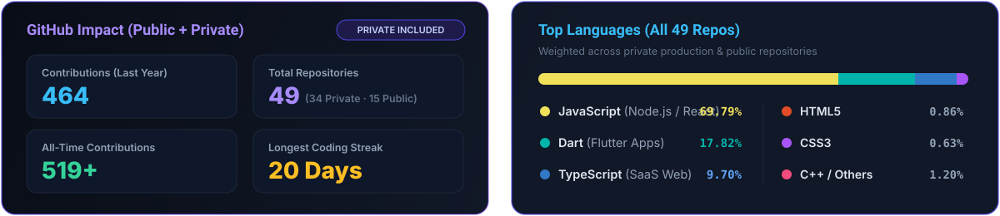

  

    

  
  
  
  

    

  

---

### 🧠 What I Architect & Lead

<table>
  <tr>
    <td width="50%" valign="top">
      <b>⚡ Backend, APIs & Real-Time Systems</b>
      <ul>
        <li>Scalable <b>Node.js & Express.js</b> architectures with modular MVC services</li>
        <li>Real-time GPS telemetry pipelines (<b>Socket.IO</b>) & live trip tracking</li>
        <li>Dynamic fare & pricing engines, automated payouts & ledger workflows</li>
        <li>Hardened <b>JWT Auth</b>, multi-role <b>RBAC</b> & S3 presigned document security</li>
      </ul>
    </td>
    <td width="50%" valign="top">
      <b>📱 Web, Mobile & Cloud Operations</b>
      <ul>
        <li>Full-stack web apps & SuperAdmin control towers in <b>React.js & Redux</b></li>
        <li>Cross-platform <b>Flutter</b> driver & customer apps with background location</li>
        <li><b>Payment Gateways</b> & subscription billing workflows</li>
        <li><b>Ubuntu VPS</b> deployment pipelines, zero-downtime releases & monitoring</li>
      </ul>
    </td>
  </tr>
</table>

---

### 🚀 Featured Production Platforms

<table>
  <tr>
    <td width="50%" valign="top">
      <h3>🚕 LOLO CAB Platform</h3>
      
<b>CTO · Apr 2026 – Present · Intercity Mobility SaaS</b>

      
End-to-end intercity cab booking ecosystem built for high-reliability operations across customer, driver, vendor, and admin portals.

      <ul>
        <li>Architected booking lifecycle, dynamic pricing & route-override engines</li>
        <li>Live driver GPS tracking, vendor/driver wallets, payouts & KYC verification</li>
      </ul>
      

        
        
        
        
      

    </td>
    <td width="50%" valign="top">
      <h3>✈️ Yoketrip Platform</h3>
      
<b>Head of Technology · Mar 2025 – Apr 2026 · Travel SaaS</b>

      
Travel booking and recurring subscription ecosystem spanning web dashboards and cross-platform mobile apps.

      <ul>
        <li>Led architecture & delivery across React.js web & Flutter mobile teams</li>
        <li>Built subscription billing, payment gateway flows & VPS release pipelines</li>
      </ul>
      

        
        
        
        
      

    </td>
  </tr>
  <tr>
    <td width="50%" valign="top">
      <h3>📍 Enterprise Attendance Platform</h3>
      
<b>Geolocation Verification · RBAC · Reporting</b>

      
Geolocation-verified workforce attendance platform with automated analytics and strict role-based access control.

      <ul>
        <li>Mobile UI: <a href="https://github.com/AjeetSln/attendanceUI"><code>AjeetSln/attendanceUI</code></a></li>
        <li>Backend API: <a href="https://github.com/AjeetSln/backendAttendance"><code>AjeetSln/backendAttendance</code></a></li>
      </ul>
      

        
        
        
      

    </td>
    <td width="50%" valign="top">
      <h3>🏢 BMSPros Australia &amp; Enterprise Web</h3>
      
<b>Administrative SaaS · Corporate Workflows</b>

      
Custom operational portals, ERP/CRM automation modules, and corporate content management systems for domestic &amp; international clients.

      <ul>
        <li><b>BMSPros Australia:</b> <a href="https://github.com/AjeetSln/bms_pro"><code>AjeetSln/bms_pro</code></a></li>
        <li><b>Vindhyasbpharma.com:</b> Corporate website &amp; admin CMS workflows</li>
      </ul>
      

        
        
        
      

    </td>
  </tr>
</table>

---

### 🛠️ Tech Stack & Infrastructure

  

 

| Layer | Technologies & Capabilities |
| :--- | :--- |
| **Frontend & Mobile** | `React.js` · `Flutter` · `Redux` · `JavaScript` · `TypeScript` · `HTML5` · `CSS3` |
| **Backend & Auth** | `Node.js` · `Express.js` · `REST APIs` · `Socket.IO` · `JWT Authentication` · `RBAC` |
| **Data & Cloud** | `MongoDB` · `Firebase` · `Ubuntu VPS` · `Payment Gateways` · `Git` · `GitHub` · `Postman` |
| **Architecture** | `SaaS Architecture` · `System Design` · `Database Design` · `API Security` · `Cloud Deployment` |

---

### 📊 GitHub Engineering Telemetry

  

 

  

  

---

  <h3>🤝 Let's Build Something Impactful</h3>
  

    Open to strategic tech collaborations, SaaS architecture discussions &amp; high-scale product engineering. 
    🎓 <b>B.Sc. Computer Science</b> (Delhi University) &nbsp;·&nbsp; 🏆 <b>micro1 AI Interview Certified</b> (Outstanding) &nbsp;·&nbsp; 🏏 Cricket &amp; Cinema
  

  
  

